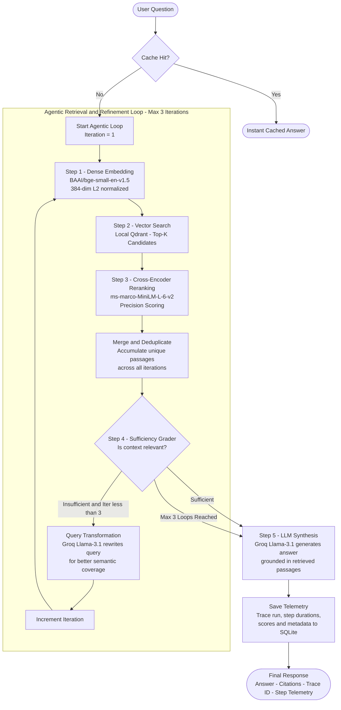

# CogniRAG — Enterprise Agentic RAG Backend

[](https://www.python.org/)
[](https://fastapi.tiangolo.com/)
[](https://groq.com/)
[](https://qdrant.tech/)
[](https://huggingface.co/spaces)
[](../LICENSE)

An advanced, production-grade **Agentic Retrieval-Augmented Generation (RAG)** platform powered by **FastAPI**, **Local Qdrant Vector Store**, **Groq LLM (Llama-3.1)**, **Sentence-Transformers Embeddings**, and **Cross-Encoder Reranking**.

Features dynamic **Query Transformation**, **Sufficiency Evaluation Grading**, an autonomous retrieval-refinement loop capped at **maximum 3 iterations**, comprehensive step-by-step telemetry, and document citations.

> **Hugging Face Spaces**: This backend is Docker SDK compatible. Set `GROQ_API_KEY` and `SECRET_KEY` in Space Secrets, and the app will be served on port `7860`.

---

## Architecture & Agentic Flow



### Step-by-Step Breakdown

| Step | Component | What Happens |
|------|-----------|--------------|
| **1. Query Reception** | FastAPI endpoint | User question arrives; cache is checked first |
| **2. Dense Embedding** | `BAAI/bge-small-en-v1.5` | Query embedded into 384-dim L2-normalized vector |
| **3. Vector Search** | Local Qdrant | Top-K semantically similar chunks retrieved |
| **4. Cross-Encoder Rerank** | `ms-marco-MiniLM-L-6-v2` | Chunks scored for passage-level relevance |
| **5. Context Merging** | Deduplication logic | Unique passages across all loops merged and re-ranked |
| **6. Sufficiency Grading** | Dual-mode grader | Score >= 1.5 = sufficient; Score <= -2.5 = transform; borderline = LLM JSON verdict |
| **7. Query Transformation** | `Groq Llama-3.1-8b` | Query rewritten with expanded semantics if context insufficient |
| **8. LLM Synthesis** | `Groq Llama-3.1-8b` | Top passages + question generates grounded answer with citations |
| **9. Telemetry Save** | SQLite / Trace DB | Full step trace (durations, scores, iterations, token stats) persisted |
| **10. Response** | JSON payload | Returns `answer`, `citations`, `trace_id`, and `steps` |

---

## Key Features

- **Autonomous Agentic RAG Loop (Max 3 Loops)**:
  - Dynamically evaluates retrieved document passages on every iteration.
  - Automatically stops early when context sufficiency is verified, or terminates safely at 3 loops to conserve tokens and reduce latency.
- **Dynamic Query Transformation / Reformulation**:
  - Leverages Groq (`llama-3.1-8b-instant`) to rewrite ambiguous, underperforming, or complex queries into semantically rich search terms.
  - Expands domain acronyms and aligns queries with vector store index representations.
- **Retrieval Sufficiency Grader (Dual-Mode)**:
  - **Fast-Path Score Evaluation**: High cross-encoder scores ($\ge 1.5$) immediately pass with 95% confidence. Low scores ($\le -2.5$) trigger transformation.
  - **LLM Grader**: Evaluates borderline candidates with structured JSON verdicts (`is_sufficient`, `confidence`, `reason`).
- **Deduplicated Cross-Loop Context Merging**:
  - Accumulates unique candidate passages across multiple attempts and reranks the entire set to select the top 5 highest-quality passages.
- **Embedded Local Disk Qdrant**:
  - Runs in-process with persistent disk storage (`./data/qdrant`), requiring zero external Docker containers or cloud accounts for local operation (seamless cloud fallback supported).
- **Two-Stage Retrieval Pipeline**:
  - **Dense Bi-Encoder**: `BAAI/bge-small-en-v1.5` (384-dimensional embeddings, L2 normalized).
  - **Cross-Encoder Reranker**: `cross-encoder/ms-marco-MiniLM-L-6-v2` for passage precision.
- **Granular Telemetry & Flow Tracing**:
  - Records step durations, intermediate candidate chunks, cosine scores, reranker scores, evaluation verdicts, and token statistics per conversation.
- **Document Management**:
  - High-performance PDF processing with PyMuPDF, semantic chunking (500 tokens with 50-token overlap), and per-page citation tracking.
- **User Authentication & Data Isolation**:
  - JWT tokens (HS256) with passlib bcrypt hashing; all documents and chats are strictly user-isolated.

---

## Technology Stack

| Layer | Component | Details |
|---|---|---|
| **Framework** | FastAPI | Async Python 3.11+, ASGI with Uvicorn |
| **LLM Inference** | Groq API | Llama-3.1-8B-Instant (ultra-low latency) |
| **Vector Database** | Qdrant | Local embedded disk folder (`./data/qdrant`) or Qdrant Cloud |
| **Embeddings** | Sentence-Transformers | `BAAI/bge-small-en-v1.5` (384-dim) |
| **Reranker** | Cross-Encoder | `cross-encoder/ms-marco-MiniLM-L-6-v2` |
| **Relational DB** | SQLite + SQLAlchemy | Async SQLite (`aiosqlite`) |
| **PDF Ingestion** | PyMuPDF (fitz) | Fast text extraction with exact page mapping |
| **Caching** | CacheTools | In-memory LRU Response & Retrieval caching |
| **Tracing** | Custom Telemetry Decorator | `@observe` tracking pipeline steps |

---

## Directory Structure

```
backend/
├── app/
│   ├── api/                    # API route controllers
│   │   ├── auth.py             # User signup, login, session
│   │   ├── chat.py             # Chat conversations & agentic messaging
│   │   ├── documents.py        # PDF document upload, listing, deletion
│   │   └── traces.py           # Pipeline execution traces & step telemetry
│   ├── core/                   # Application configuration & database setup
│   │   ├── config.py           # Pydantic Settings & environment variables
│   │   ├── database.py         # Async SQLite engine & session maker
│   │   └── security.py         # Password hashing & JWT token management
│   ├── models/                 # SQLAlchemy ORM models
│   │   ├── user.py             # User entity
│   │   ├── document.py         # Document & chunk entities
│   │   ├── chat.py             # Chat & message entities
│   │   └── trace.py            # Trace run & step entities
│   ├── schemas/                # Pydantic request & response validation schemas
│   │   ├── auth.py
│   │   ├── chat.py
│   │   ├── document.py
│   │   └── trace.py
│   ├── services/               # Core business logic & AI pipelines
│   │   ├── cache_service.py    # LRU response & retrieval cache
│   │   ├── chat_service.py     # Agentic RAG loop orchestrator (Max 3 loops)
│   │   ├── document_service.py # PDF parsing, chunking, and indexing
│   │   ├── embedding_model.py  # Dense vector generation (BGE-small)
│   │   ├── llm_service.py      # Groq generation, query transformation, grading
│   │   ├── reranker.py         # Cross-Encoder passage scoring
│   │   ├── trace_service.py    # Step telemetry storage & retrieval
│   │   └── vector_store.py     # Qdrant client abstraction (local/cloud)
│   └── main.py                 # FastAPI application factory & lifecycle
├── data/                       # Local SQLite DB and Qdrant storage (gitignored)
│   ├── qdrant/                 # Embedded Qdrant vector index
│   └── rag.db                  # Relational metadata database
├── Dockerfile                  # Container definition for local & HF Spaces
├── requirements.txt            # Python dependencies
├── .env                        # Local environment variables
└── README.md                   # Project documentation
```

---

## Environment Variables

Configure these in `backend/.env` (or Hugging Face Space Secrets):

| Variable | Default Value | Description |
|---|---|---|
| `APP_NAME` | `RAG Platform` | Application title |
| `FRONTEND_URL` | `http://localhost:5173` | Allowed CORS origin |
| `SECRET_KEY` | `your-secret-key` | Secret key for JWT signing |
| `ALGORITHM` | `HS256` | JWT encoding algorithm |
| `ACCESS_TOKEN_EXPIRE_MINUTES` | `60` | Token expiration time in minutes |
| `DATABASE_URL` | `sqlite+aiosqlite:///./data/rag.db` | Async database connection URL |
| `QDRANT_URL` | `./data/qdrant` | Disk folder path for local Qdrant or cloud URL |
| `QDRANT_API_KEY` | `""` | API key for Qdrant Cloud (leave empty for local) |
| `GROQ_API_KEY` | `""` | Groq API key for Llama-3.1 inference |
| `GROQ_MODEL` | `llama-3.1-8b-instant` | Groq model identifier |

---

## Getting Started

### 1. Prerequisites
- Python 3.10+ (Python 3.11 recommended)
- A free [Groq Cloud API Key](https://console.groq.com/)

### 2. Local Setup

```bash
# Navigate to backend directory
cd backend

# Create and activate a Python virtual environment
# Windows:
python -m venv venv
.\venv\Scripts\activate

# Linux / macOS:
python3 -m venv venv
source venv/bin/activate

# Install dependencies
pip install --upgrade pip
pip install -r requirements.txt
```

### 3. Configure Environment

Create a `.env` file in the `backend/` folder:

```ini
APP_NAME=RAG Platform
SECRET_KEY=generate_a_random_32_byte_hex_string_here
ALGORITHM=HS256
ACCESS_TOKEN_EXPIRE_MINUTES=60
DATABASE_URL=sqlite+aiosqlite:///./data/rag.db
QDRANT_URL=./data/qdrant
QDRANT_API_KEY=
GROQ_API_KEY=gsk_your_groq_api_key_here
GROQ_MODEL=llama-3.1-8b-instant
FRONTEND_URL=http://localhost:5173
```

### 4. Run the Server

```bash
# Start FastAPI with live reload
uvicorn app.main:app --host 0.0.0.0 --port 7860 --reload
```

The interactive OpenAPI / Swagger documentation will be available at:
**[http://localhost:7860/docs](http://localhost:7860/docs)**

---

## API Reference

### Health
- `GET /health`: Health-check endpoint returning `{"status": "healthy"}`.

### Authentication
- `POST /api/auth/register`: Create user account (`email`, `password`, `full_name`).
- `POST /api/auth/login`: Authenticate and obtain JWT bearer token.
- `GET /api/auth/me`: Get current authenticated user details.

### Documents
- `POST /api/documents/upload`: Upload PDF file for extraction, chunking, and vector indexing.
- `GET /api/documents`: List all uploaded documents with status and chunk counts.
- `DELETE /api/documents/{id}`: Delete a document and purge its vectors from Qdrant.

### Agentic Chat
- `GET /api/chat/conversations`: List user conversation threads.
- `POST /api/chat/conversations`: Create a new conversation (`title`).
- `GET /api/chat/conversations/{id}`: Retrieve chat thread and previous messages.
- `DELETE /api/chat/conversations/{id}`: Delete conversation history.
- `POST /api/chat/conversations/{id}/messages`: Submit prompt to trigger the **Agentic RAG Pipeline**.
  - **Response Payload**:
    - `answer`: LLM synthesized response.
    - `citations`: Verified source chunks (`id`, `filename`, `pages`, `content`).
    - `trace_id`: Unique identifier for the execution run.
    - `steps`: Step-by-step telemetry list (name, duration, status, trace metadata).

### Traces & Telemetry
- `GET /api/traces`: List historical pipeline execution runs with total latencies.
- `GET /api/traces/{trace_id}`: Detailed step breakdown and metadata for an execution run.

---

## Docker & Hugging Face Spaces Deployment

The backend is packaged for deployment on Docker or **Hugging Face Spaces**.

```bash
# Build Docker image
docker build -t cognirag-backend .

# Run container on port 7860
docker run -p 7860:7860 \
  -e GROQ_API_KEY="your-groq-key" \
  -e SECRET_KEY="your-secret-key" \
  cognirag-backend
```

For **Hugging Face Spaces**:
1. Create a new Space with the **Docker** SDK.
2. Push the contents of the `backend/` folder to the Space repository.
3. Add `GROQ_API_KEY` and `SECRET_KEY` in **Space Settings > Secrets**.
4. The Space will automatically build and serve the API on port `7860`.